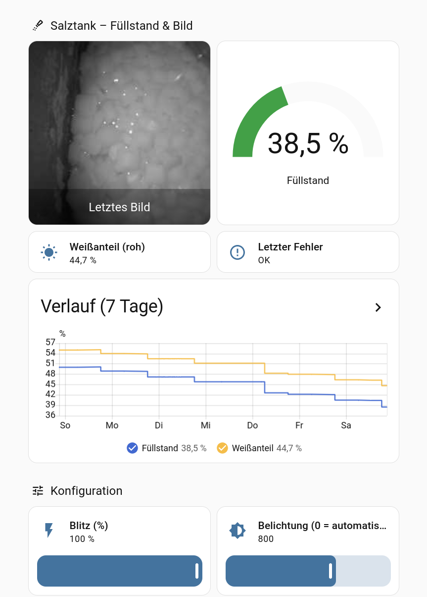

# ESP32 Salt Cam – Salztank-Füllstand per Kamera

Eine ESP32-CAM schaut von oben in den Salztank einer Wasserenthärtungsanlage. In einem
einstellbaren Intervall macht sie ein Foto mit Blitz, zählt die hellen (weißen) Pixel und meldet
daraus den Füllstand in Prozent an Home Assistant. Die Kommunikation läuft ausschließlich über
**MQTT mit Discovery**. Die Firmware basiert auf **ESPHome** mit einer eigenen C++-Komponente.



## Funktionsweise

1. Kamera einschalten (mit Wiederholungen, falls der Sensor nicht sofort antwortet).
2. Blitz-LED an, ein paar Einschwing-Frames verwerfen, ein Graustufenbild aufnehmen, Blitz aus.
3. Kamera wieder ausschalten, denn die laufende Kamera stört das WLAN massiv.
4. **Weißanteil** = Anteil der Pixel mit Grauwert ≥ `Schwellwert`.
5. **Füllstand** = Weißanteil, linear abgebildet zwischen `Referenz leer` (0 %) und `Referenz voll` (100 %).
6. Ergebnis, JPEG-Bild und Diagnose-JSON per MQTT senden.

Je weniger Salz im Tank liegt, desto mehr dunkle Tankwand und Sole sieht die Kamera und desto
kleiner wird der Weißanteil.

## Was man braucht

### Hardware

| Teil | Hinweis |
|---|---|
| **ESP32-CAM (AI-Thinker-Layout)** | Klassischer ESP32 mit 4 MB Flash und PSRAM. Getestet mit **OV3660**. Ein OV2640 sollte ebenfalls gehen, ist aber nicht getestet. |
| **USB-Seriell-Adapter** | z. B. FT232 (3,3-V-Pegel) oder das ESP32-CAM-MB-Programmierboard mit USB. Nur für das erste Flashen nötig, danach geht alles per OTA. |
| **5-V-Netzteil** | Mindestens 1 A und stabil. Die ESP32-CAM reagiert empfindlich auf Spannungseinbrüche (Blitz und WLAN gleichzeitig). |
| **Befestigung im Tankdeckel** | Halterung oder Gehäuse, damit die Kamera senkrecht auf das Salz schaut. Die Platine vor Feuchtigkeit und Salzstaub schützen. |
| optional: externe Antenne | Die PCB-Antenne ist schwach. Im Keller auf ausreichende WLAN-Signalstärke achten. |

Als Lichtquelle dient die **weiße Blitz-LED auf der ESP32-CAM (GPIO4)**. Im geschlossenen Tank ist
es sonst komplett dunkel, deshalb ist der Blitz die einzige und damit eine konstante Lichtquelle.

Die Schärfe stellt man am Drehring des Objektivs ein (ggf. vorher den Klebepunkt vorsichtig lösen).

### Software

- **Home Assistant** mit MQTT-Broker (z. B. Mosquitto-Add-on) und MQTT-Integration
- **Podman** (oder Docker; dann `podman` in `scripts/*.sh` ersetzen). ESPHome läuft im Container,
  fest auf Version **2026.9.0**.
- **esptool** auf dem Host für das erste Flashen per USB

## Nachbauen

### 1. Repository klonen und Secrets anlegen

```bash
git clone https://github.com/unix0r/esp32-salt-cam.git
cd esp32-salt-cam
cp secrets.example.yaml secrets.yaml
```

In `secrets.yaml` kommen WLAN (2,4 GHz), MQTT-Broker (IP des Home-Assistant-Hosts, nicht
`core-mosquitto`), MQTT-Benutzer und ein OTA-Schlüssel:

```bash
openssl rand -base64 32   # -> ota_key
```

Für MQTT am besten einen eigenen Benutzer in Home Assistant anlegen.

### 2. Gerät anpassen

`saltcam-tank1.yaml` ist der Einstiegspunkt pro Gerät:

```yaml
substitutions:
  node_name: saltcam-tank1
  friendly_name: "Salztank 1"
  mqtt_topic_prefix: saltcam/tank1
```

Für einen zweiten Tank die Datei kopieren und diese drei Werte ändern. Weitere Standardwerte
(Auflösung, JPEG-Qualität, Startwerte für Schwellwert, Intervall und Blitz) stehen als
`substitutions` in `packages/camera.yaml` und `packages/salt_level.yaml`. Sie lassen sich in der
Gerätedatei überschreiben.

### 3. Bauen

```bash
scripts/esphome.sh config     # Konfiguration prüfen
scripts/esphome.sh compile    # Firmware bauen
scripts/test_host.sh          # Unit-Tests der Bildauswertung (auf dem PC)
```

### 4. Erstes Flashen per USB

ESP32-CAM mit dem Adapter verbinden (TX↔RX, RX↔TX, GND, 5 V). Bei einem einfachen Adapter beim
Einschalten **GPIO0 auf GND** legen (Bootloader-Modus). Beim ESP32-CAM-MB-Board übernehmen das der
Taster bzw. die Auto-Reset-Schaltung.

```bash
esptool.py --chip esp32 --port /dev/ttyUSB0 write_flash 0x0 \
  .esphome/build/saltcam-tank1/build/firmware.factory.bin
```

Der Serial-Port ist im rootless-Container nicht erreichbar, deshalb läuft `esptool` direkt auf dem Host.

Danach GPIO0 lösen und neu starten. Alle weiteren Updates gehen per OTA:

```bash
scripts/esphome.sh run --device <IP-Adresse>
```

### 5. Home Assistant

Über MQTT-Discovery erscheint automatisch ein Gerät „Salztank 1“ mit allen Entities (siehe unten).
Ein Dashboard wie im Screenshot lässt sich z. B. so bauen:

```yaml
type: vertical-stack
cards:
  - type: grid
    columns: 2
    square: false
    cards:
      - type: picture-entity
        entity: camera.salztank_1_kamera
        name: Letztes Bild
        show_state: false
      - type: gauge
        entity: sensor.salztank_1_fullstand
        name: Füllstand
        min: 0
        max: 100
        severity:
          green: 30
          yellow: 15
          red: 0
  - type: history-graph
    title: Verlauf (7 Tage)
    hours_to_show: 168
    entities:
      - sensor.salztank_1_fullstand
      - sensor.salztank_1_weissanteil
```

Die Entity-IDs hängen vom `friendly_name` ab. Im Zweifel unter *Einstellungen → Geräte* nachsehen.

### 6. Montieren und kalibrieren

1. Kamera im Tankdeckel montieren, `Jetzt messen` drücken und die Schärfe am Objektiv nachstellen.
2. **Blitz** so einstellen, dass das Salz gut ausgeleuchtet, aber nicht überstrahlt ist
   (hier: 100 %). Danach nicht mehr ändern, denn jede Änderung verschiebt die Referenzen.
3. **Belichtung fixieren:** `Belichtung` auf einen Wert > 0 setzen (hier 800, der OV3660 sättigt
   etwa dort) und `Gain` auf 0. Mit automatischer Belichtung würde die Kamera dunklere Bilder
   (wenig Salz) wieder aufhellen und so den Weißanteil verfälschen.
4. **Schwellwert** zwischen die Grauwerte von Hintergrund und Salz legen. Im Histogramm sieht man
   zwei Gruppen (hier: Hintergrund ≈ 52, Salz ≈ 162, Schwellwert 107).
5. Direkt nach dem Nachfüllen **`Tank voll`** drücken, kurz vor dem nächsten Nachfüllen
   **`Tank leer`**. Die jeweils nächste Messung wird als Referenz gespeichert. Ohne „leer“ gilt
   ein Weißanteil von 0 % als leer.

## Entities in Home Assistant

| Entity | Zweck |
|---|---|
| `Füllstand` | Ergebnis in % (linear zwischen „Referenz leer“ und „Referenz voll“) |
| `Weissanteil` | Anteil der Pixel ≥ Schwellwert, roh |
| `Kamera` | Letztes Bild (Graustufen-JPEG) |
| `Letzter Fehler` | `OK` oder Fehlercode mit Text |
| `Jetzt messen` | Sofortmessung, unabhängig vom Intervall |
| `Messintervall` | Stunden zwischen zwei Messungen (0,25–168, Standard 12) |
| `Schwellwert` | Grauwert 0–255, ab dem ein Pixel als Salz zählt |
| `Blitz` | Helligkeit der Blitz-LED in %, nur während der Aufnahme an. 0 = kein Blitz |
| `Belichtung` / `Gain` | 0 = automatisch, sonst feste Werte (Gain zählt nur dann) |
| `Referenz voll` / `Referenz leer` | Weißanteil bei vollem bzw. leerem Tank |
| `Tank voll` / `Tank leer` | Die nächste Messung wird die jeweilige Referenz |
| Diagnose | WLAN-Signal, Uptime, freier Heap/PSRAM, Reset-Grund, IP-Adresse |

Alle Einstellungen überstehen einen Neustart (`restore_value`), die MQTT-Kommandos sind retained.
Nach drei fehlgeschlagenen Messungen in Folge gehen `Füllstand` und `Weissanteil` auf „unbekannt“.

### MQTT-Topics

| Topic | Inhalt |
|---|---|
| `<prefix>/camera/image` | JPEG als Binärdaten |
| `<prefix>/camera/meta` | Diagnose-JSON pro Aufnahme (`event`, `seq`, `bytes`, `init_attempts`, `white_pct`, `level_pct`, Heap …) |
| `<prefix>/log` | Warnungen und Fehler |

## Projektstruktur

| Pfad | Inhalt |
|---|---|
| `saltcam-tank1.yaml` | Einstieg pro Gerät (Name, Topic-Präfix) |
| `boards/esp32cam_aithinker.yaml` | Board, PSRAM, Kamera-Pins |
| `packages/` | `base` (WLAN, MQTT, OTA, Safe Mode), `camera`, `diagnostics`, `salt_level` (Entities) |
| `components/salt_level/` | ESPHome-Komponente in C++: Kamera, Messung, Kalibrierung, MQTT-Bildversand |
| `tests/host/` | Unit-Tests der reinen Bildlogik (laufen auf dem PC) |
| `samples/` | Beispielbilder aus dem Tank |
| `bringup/` | Gegentest mit ESPHomes Standardkamera auf dem Arduino-Framework (nur zur Fehlersuche) |
| `scripts/` | ESPHome und Tests im Container |

## Wissenswertes zur Hardware

- **Die Kamera stört das WLAN:** Mit laufendem Kamera-Takt lag der Paketverlust bei ca. 90 %. Die
  Kamera ist deshalb nur während einer Aufnahme an: Init → Bild → aus → senden.
- **Der OV3660-Init ist zickig:** Der Sensor braucht oft mehrere Anläufe. Die Komponente wiederholt
  den Init mit Pausen, ohne Neustart. Mit dem *legacy*-SCCB-Treiber wird der Sensor zuverlässig erkannt.
- **Warum nicht `esp32_camera`?** ESPHomes Kamera-Komponente versucht den Init nur einmal, markiert
  sich danach als fehlerhaft und nutzt einen SCCB-Treiber, mit dem dieser Sensor auf diesem Board
  kaum erkannt wird. Außerdem lässt sie die Kamera dauerhaft laufen.
- **Pins:** AI-Thinker-Standard (D4 = GPIO36). GPIO16 hängt am PSRAM. GPIO4 (Blitz) teilt sich den
  Pin mit der SD-Karte, die deshalb nicht genutzt wird.
- **Kein `api:`**: Home Assistant ist ausschließlich über MQTT angebunden.

## Lizenz

[MIT](LICENSE) © 2026 Artur Dick
